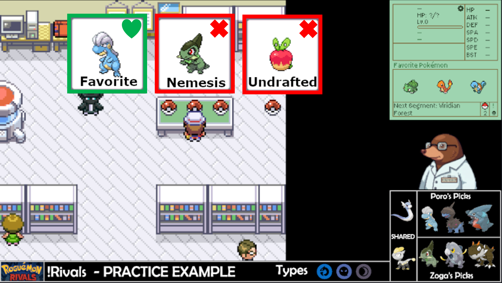
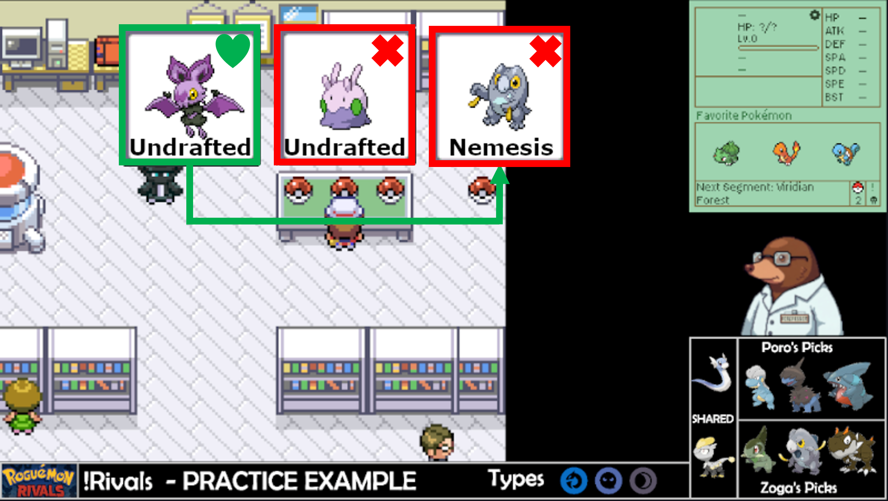
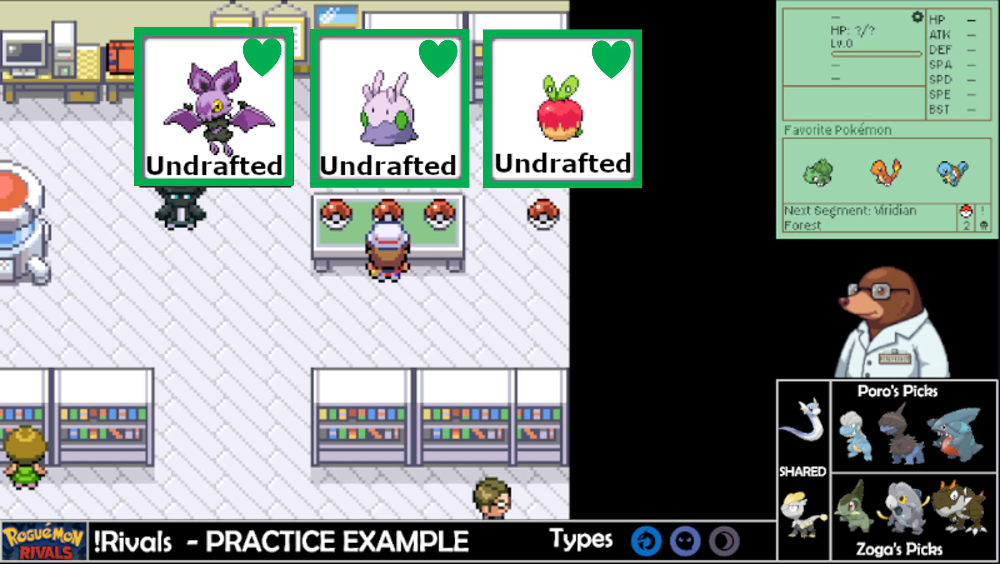

# All-Stars-2026

### [DRAFTING PHASE](#DRAFTING-PHASE) | [PIVOTING GUIDELINES](#PIVOTING-GUIDELINES) | [TIEBREAKERS](#TIEBREAKERS) | [RESOURCES](#RESROUCES) | [FAQ](#FREQUENTLY-ASKED-QUESTIONS) |

---

Welcome to Roguemon Rivals All-Stars! After our four seasonal tournaments in 2026, we are here to celebrate the competitors who have fought to the top of the ranks. All-Stars will consist of 12 players divided into two teams battling it out in head to head competition. These 12 players will consist of the top 10 players across the year and 2 community voted players. Each team will divide all 18 types across their players (3 types per player). Competitors from both teams will battle it out in 1v1 match-ups to see who can get the furthest run (PB). At the end of the competition, the team with the most type wins is declared the champions!

---

<h1 align="center">Drafting Phase</h1>

Players will draft favorites which they must run and universal picks which both players can run. This can be organized through voice chat or text chat in Discord. In the past Discord DMs have worked very successfully for the drafting phase. The overall process should take about 5 minutes if you have a general idea who you want to draft. Please note that the pick order in the draft phase will be announced after the type selection is finalized.

Once players have drafted all of their Pokemon, the Running phase begins. This means go play! This will proceed like normal A2 Roguemon with the exception of how you pivot (see below).

### 
Drafting Phase Reference

If you want to make things interesting, feel free to use any combination of the Champion boons from this year as a house rule! Just make sure that both players agree to using them. Also, feel free to make your own or edit them to your preferences.

<strong>List of Optional Champion Boons</strong>

  
| Boon | Description | Availability | Types |
|:---:|---|---|
| **Anti-Social** | The top 10% of community universal votes are banned unless they win the popular vote | All Types |
| **Dictator** | The leader decides all communal universal picks | All Types |
| **Double Trouble** | All favorite picks must contain dual typing |              |
| **Draft with Phonics** | Drafts must be picked in alphabetical order | All Types |
| **False Start** | All base game starters are banned from drafting |    |
| **Foster Care** | If a favorite is in the abandoned balls, you must take them | All Types |
| **Insufficient Funds** | Ookemon with BST > 399 are banned from drafting | All Types |
| **Late Bloomers** | Pokemon that would evo in the forest are banned from drafting |           |
| **Monoculture** | All dual tpying Pokemon are banned from drafting |           |
| **Weekly Allowance** | Each player's draft may not exceed a BST Limit | All Types |
| **Babysitting** | At least one of your favorites must be a sub-300 BST Pokemon | All Types |
| **Bougie** | Every player must draft a roguestone evolution first | All Types |
| **Collapsed Mine** | Pokemon that utilize Roguestone Evolutions are banned from drafting |              |
| **Feel the Rainbow** | Every Player's draft must have at least 3 unique types | All Types |
| **Influencer** | All players must draft a favorite of your choice | All Types |
| **Lone Wolves** | Pokemon that utilize friendship evolutions are banned from drafting |           |
| **Old Dog** | At least one of your favorites must learn 3 or less moves before evo | All Types |
| **Blacklisted** | Ban a Pokemon from the draft phase (universal vote AND autodrafter) | All Types |

---

<h1 align="center">PIVOTING GUIDELINES</h1>

Pivoting is dictated by what you drafted. Unlike the classic ruleset for Roguemon Rivals, All-Stars does not require the abandoned balls. **Repeat everyone can scout for their favorites!** Since scouting is allowed, you can ONLY run your favorite pokemon. Undrafted Pokemon can be used up until the first trainer, but cannot be used as a runner. Nemesis Pokemon are are banned outside of the lab. With that in mind, the lab rules are:

### Lab Priorities:
1.	You must select a drafted pokemon (Universal or Your Favorite)

<strong>Example</strong>

  

In this example, there is a favorite (Pokemon you drafted or universal pick), a nemesis (Pokemon your opponent drafted), and an undrafted pick.

2.	If you don’t have a favorite, you must fight your opponent’s favorite

<strong>Example</strong>

  

3.	If there are no favorites for either player, you have free choice.

<strong>Example</strong>

  

---

<h1 align="center">Tiebreakers</h1>

In the case of both players ending on the same segment, there are a few tiebreakers to determine the winner:
1) The player that defeated the most trainers in the final segment wins the tiebreaker.
2) If both players defeated the same number of trainers, then the player who defeated the most pokemon in the final segment wins the tiebreaker.
3) If both players defeated the same number of trainers and pokemon, then the player with the next highest PB wins.

---

<h1 align="center">RESOURCES</h1>

<strong>📁 Resources</strong>

[Draft Tracker](https://docs.google.com/spreadsheets/d/1w-vIBTVtaFTtdZ5n6jUGxO-SaW-L_5P-QvtL8cfddMo/edit?gid=1594516166#gid=1594516166)

[Pivot Data and Rankings](https://docs.google.com/spreadsheets/d/1zq-M--9Jb4GTpdZMbvmEHwkKGRNkcs_fxrWiKGcLMkY/edit?usp=sharing)

[Pokemon Sprites (Sugimori and Global Artwork)](https://drive.google.com/drive/folders/1QnI2yFlTVyjq3geyzwmnrr3_cxNlNjzI?usp=sharing)

[Pixel Sprites](https://drive.google.com/drive/folders/1IMru_qBCG5OpRwzBwaMIdA040vXDoIP7)

---

<h1 align="center">FREQUENTLY ASKED QUESTIONS</h1>

<strong> How do we decide who drafts first? </strong>

This will be announced / updated once the type match-ups have been finalized.
 

<strong> What happens if all lab mons are unselectable? </strong>

Any seeds with only rival Pokemon in the lab should be reset and will not count towards your 50 seeds. This is what we call a seed refund.
 

<strong> What happens if I my lab pokemon has Pure/Huge Power and I only have physical moves? </strong>

Thats a seed reset, but you will be refunded the seed. Please note this doesn't apply to type resistances.
 

<strong> If I get a non-favorite shiny, can I run that instead of a favorite? </strong>

With the implementation of shiny charms, shinies are much more consistent. Therefore, non-favorites shinies are not allowed.
 

<strong> Do I need to stream every seed attempt? </strong>

Yes! In order to verify each run and guarantee a fair competitive environment the runs must be watchable. You don't need a webcam and microphone, just visible gameplay. Please make sure that your VODs are available through your preferred streaming service.
 

<strong> Is Discord a permissible alternative to streaming? </strong>

Unfortunately, it is not since the VODs would not be viewable after you ended the run.
 

 
---

## Credits
Updated Rules and A2 Format Created by: [ThePorofessor](https://www.twitch.tv/theporofessor) and [ZogaOak](https://www.twitch.tv/zogaoak)

Draft Tracker Created by: [iAmSlammer](https://www.twitch.tv/iAmSlammer)

<i>Roguemon Rivals is a fan-made competition format and not affiliated with Nintendo, Game Freak, or The Pokémon Company.</i>

